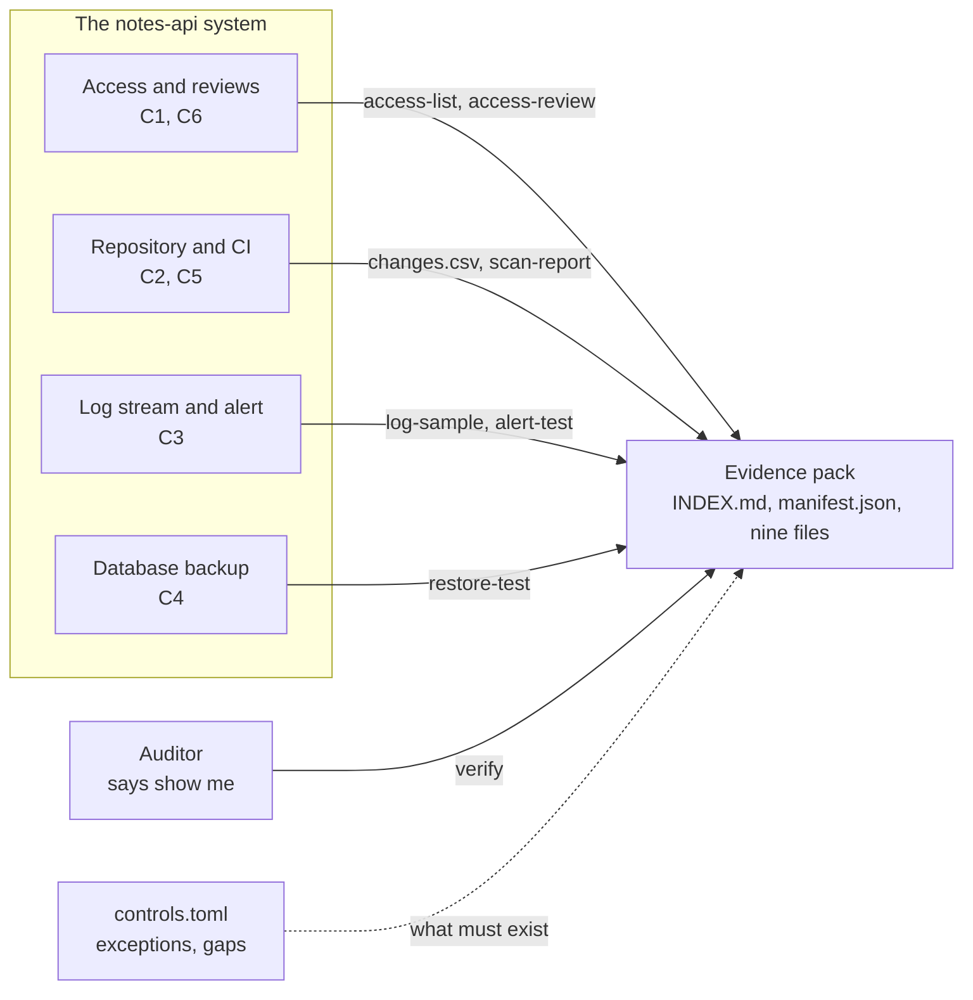

# Architecture: a service and the evidence that its controls work

Component names match the lesson's diagram ("From a control to the evidence an auditor reads"): **Auditor**, **Evidence pack**, **Access and reviews**, **Repository and CI**, **Log stream and alert**, **Database backup**, all around the **notes-api system**.

## Components and what each owns

| Component | Where it lives | What it owns |
| --- | --- | --- |
| **notes-api system** | [application/notes_service.py](src/notes_evidence/application/notes_service.py), [interfaces/http_app.py](src/notes_evidence/interfaces/http_app.py), [sql/](sql) | The service the controls are about: login, notes, role grants; every action checked against the role and recorded. |
| **Access and reviews** (C1, C6) | [domain/access.py](src/notes_evidence/domain/access.py), [domain/review.py](src/notes_evidence/domain/review.py), `PostgresRoles`, `sources.py` | The list of who can reach what, and the review that decides every access and removes the refused one. |
| **Repository and CI** (C2, C5) | [domain/changes.py](src/notes_evidence/domain/changes.py), [domain/scan.py](src/notes_evidence/domain/scan.py), `sources.py`, `scanner.py` | Merged changes with approvers and deployment ids; the dependency scan with the run that made it. |
| **Log stream and alert** (C3) | [domain/audit.py](src/notes_evidence/domain/audit.py), [domain/alerts.py](src/notes_evidence/domain/alerts.py), `PostgresAuditLog` | The audit event, the fixed-field log line, and the alert rules (five failed logins in two minutes, an admin role granted). |
| **Database backup** (C4) | [domain/restore.py](src/notes_evidence/domain/restore.py), `backup.py` | A real dump, a restore into a scratch database, the row counts and the time. |
| **Evidence pack** | [domain/evidence.py](src/notes_evidence/domain/evidence.py), [domain/controls.py](src/notes_evidence/domain/controls.py), `evidence_store.py`, [application/evidence_collect.py](src/notes_evidence/application/evidence_collect.py) | The control matrix, the manifest, the index, and the rules `verify` applies. |
| **Auditor** | `controls-evidence verify` and `report` | The same questions an auditor asks, answered by a program: does each control have evidence, does the file exist and say what it should, was it edited. |

## Pattern: ports and adapters, with the controls as use cases

Every system a control reads sits behind a port (`RepositoryAccess`, `DatabaseAccess`, `CloudDirectory`, `ChangeSource`, `AuditLog`, `BackupRunner`, `ScanRunner`, `EvidenceStore`). A collector is a use case that asks a port, renders an artifact in the domain, and writes it with its manifest entry. The notes service uses the same style (`UserRepository`, `NoteRepository`, `AuditLog`, `PasswordHasher`, `TokenService`, `Clock`), so the controls are tested with in-memory ports and the adapters against PostgreSQL. This fits because the lesson's point is the link between a control and an artifact; each artifact has one writer and one checker.

## Data flow

Drawn versions of this figure and of the walk-through: [the architecture](docs/diagrams/architecture.svg) and [one run](docs/diagrams/flow.svg).

### One run, step by step (`make run`)

1. The Makefile resets the database (`sql/reset.sql`, then the schema and the seed) and clears `state/` and `evidence/`.
2. `exercise`: four accounts are created by the administrative connection with throwaway passwords that exist only in memory, then used through `NotesService`: logins, notes created, read, updated, deleted, two requests refused. Every action lands in `audit_log`.
3. `alert-test`: five wrong passwords for `bruno` and an admin grant are real calls; the trail since the start of the test is read back, the alert rules run over it, each alert goes to the sink, and `C3-alert-test.txt` keeps the alerts beside the time of the test action.
4. `log-sample`: the last 20 audit events, rendered as fixed-field lines.
5. `access`, `changes`: the three systems' access (a live `pg_roles` query plus the repository and cloud parts) and the merged changes joined to the deployment log.
6. `restore-test`: `pg_dump` inside the container, a restore into `notes_restore_test`, the row count before and after, the time; the scratch database is dropped even if the restore fails.
7. `scan`: `pip-audit` over `requirements.lock`, wrapped with the run id.
8. `review`: C1 is collected, every access is matched with a decision, leavers cannot be kept (ARV003), the refused access is removed from the cloud directory, C1 is collected again, and `C6-access-review.md` shows before, removed, after and the proof.
9. `index`: `INDEX.md` from the matrix and the manifest, with the exceptions, the gaps and the framework overlap.
10. `verify` applies EVD001 to EVD009 to the folder and the process exits 0 or 1.

## Decisions and trade-offs

- **Evidence is produced and hashed (ADR 0001).** The manifest turns "nobody edited it" into a check; it does not stop an attacker who also edits the manifest.
- **The audit log is append-only in the database (ADR 0002).** The application role cannot rewrite history, and a trigger stops even the superuser from updating or truncating it.
- **Fixtures with live adapters (ADR 0003).** The shapes are real, the sources are invented, and the README says which is which.
- **pg_dump inside the container (ADR 0004).** The tools always match the server's version.
- **A control's content check recomputes the claim.** `verify` re-derives the exceptions from the CSV and checks that a removed principal is absent from the current access list; it does not trust a summary line.
- **Warnings for age, errors for absence.** A stale artifact (older than its refresh period) is a warning, because a pack that fails the day after it is made would be useless in a repository; a missing, empty, edited or unclaimed file is an error.
- **Passwords: scrypt from the standard library.** Salted, slow, constant-time comparison, no extra dependency; the seeded accounts carry a hash that can never match.
- **Roles: least privilege as a table.** `GRANTS` in `domain/roles.py` is the whole policy; the database grants mirror it (the application role can change a user's role but not create users or touch password hashes).
- **One connection per process.** A connection per query opened thousands of short TCP connections during a collector run and exhausted the machine's ephemeral ports; a gunicorn synchronous worker needs one. A threaded server needs a pool.

## Failure modes the lesson teaches, and how the code shows them

| Mistake (lesson, "Common mistakes") | How it shows here |
| --- | --- |
| Producing the artifact by hand | The manifest hash fails (EVD003); the collectors are the only writers. |
| Listing a policy as evidence | A control's evidence has a `kind`, and each kind has a content check (EVD007). |
| Testing the alert by reading its configuration | The alert test does the thing and reads the audit table; the file must hold `test action at` and an `ALERT [...]` with a timestamp not earlier than the action. |
| Never restoring a backup | `restore` evidence must say `result: verified` from row counts. |
| Reviewing access and removing nothing, or without a record | ARV001 to ARV003 and EVD007: every access decided, no leaver kept, "Removed: nothing" is an error. |
| Hiding exceptions | EVD006: an exception found in the CSV that is not in `exceptions.toml` with a follow-up fails. |

## Limits of the teaching build against a production one

- The evidence folder is in the repository; production evidence goes to write-once storage with access logging.
- Fixture mode shows the shape of C1, C2 and C6 sources, not a real organization's; the live adapters are untested against a real account.
- Only cloud users can be removed by the review; the repository and database owners would act on their own systems.
- Alerts go to a file. Real alerting needs a destination, an on-call rota and a test on a schedule.
- The restore test holds the dump in memory and drops it at the end, which stops working for databases of gigabytes.
- Backup encryption (C7) is a gap, tracked, not built.

## How to extend it

Add a control: a `[[control]]` in `controls/controls.toml` with its evidence kinds, a collector in `application/evidence_collect.py`, a content check in `domain/evidence.py` and the artifact renderer in the domain. Close the C7 gap: encrypt the dump, add an evidence kind that checks it, delete the gap record. Point the sources at a real account with `EVIDENCE_SOURCE=live`.
